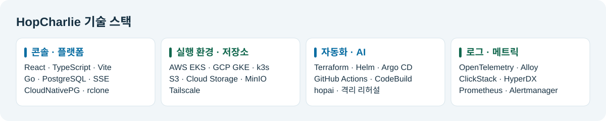

<!-- Absolute URLs keep documents and images accessible from the GitHub organization profile. -->

  

<h1 align="center">HopCharlie</h1>

<strong>Plan migrations for live apps and verify the results of each cutover.</strong>

A management platform that synchronizes databases and files across AWS, GCP, and on-premises environments, then switches traffic according to a plan approved by a human operator.

  <a href="https://github.com/2026-Softbank-Hackathon-Charlie" lang="ko">한국어</a> ·
  <strong>English</strong> ·
  <a href="https://github.com/2026-Softbank-Hackathon-Charlie/.github/blob/main/profile/README.ja.md" lang="ja">日本語</a>

  <a href="https://github.com/2026-Softbank-Hackathon-Charlie/frontend#readme">Local demo</a> ·
  <a href="https://github.com/2026-Softbank-Hackathon-Charlie/platform/blob/main/docs/e2e/2026-11-08/README.md">Finals verification record</a> ·
  <a href="#purpose">Motivation</a> ·
  <a href="#features">What HopCharlie offers</a> ·
  <a href="#architecture">Architecture</a> ·
  <a href="#team">Team</a>

> **SoftBank Hackathon 2026 in Korea · Finals · Team Charlie** 
> Under the theme **Beyond Lock-in**, we built a workflow for moving live apps and their data to a different environment.

## Motivation

> “Can we move the data while the source is still serving requests?” “When should we switch traffic, and where do we fall back if something fails?”

Migrating a live app requires coordinating data replication with the traffic cutover. HopCharlie gives operators one execution record where they can see the migration plan, cutover conditions, and verification results.

| Migration challenge | HopCharlie's approach |
|---|---|
| Connection, version, and policy requirements must be checked for each environment | Gather evidence for the plan with environment preflight checks and an **AI sandbox rehearsal** |
| The source app keeps receiving writes during replication | Synchronize while the source serves requests and **switch traffic after verifying the final write** |
| After a failure, it is hard to tell how to recover or whether any data was lost | Record recovery conditions for each stage, along with **data comparisons and request outcomes** |

## Features · What HopCharlie offers

**AI proposes a plan, and an operator reviews the rehearsal results before approving execution.**

| Feature | What the operator does | What HopCharlie provides |
|---|---|---|
| **Select migration environments** | Choose the app, source, and destination | Preflight checks for environments, versions, capacity, and policies |
| **Plan and rehearse** | Review the AI-proposed plan and its supporting evidence | An isolated rehearsal using a temporary CNPG instance and synthetic data |
| **Approve and synchronize** | Review and approve the plan | PostgreSQL WAL replication, plus file copying and comparison with rclone |
| **Switch traffic** | Monitor the write hold, promotion, and cutover | Finish in-flight writes, verify the target, then route traffic to a single write target |
| **Review results and recovery** | Check for missing data, review request outcomes and latency, and check recovery status | A report for each run, plus source recovery at a safe point or a pause for operator review |

**Typical workflow**

1. In the console, choose the app and migration direction.
2. Review the AI plan and rehearsal evidence.
3. The operator approves the plan and requests execution.
4. Follow progress through **synchronization → write hold → cutover**.
5. Review the verification scope and request outcomes on the results screen.

[Console screenshots](https://github.com/2026-Softbank-Hackathon-Charlie/frontend/blob/main/docs/HISTORY.md) · [AI rehearsal implementation](https://github.com/2026-Softbank-Hackathon-Charlie/ai-sandbox)

## System architecture

AWS has separate **management EKS** and **workload EKS** clusters. The management cluster controls the platform and deployments; the workload cluster runs apps deployed on AWS.

| Component | Responsibility |
|---|---|
| **Operations Console · CLI** | Select the environment and app, approve plans, and check migration progress and results |
| **Platform API** | Check policies and environments, manage plans, approvals, and execution status, and forward events |
| **AI Runner · Sandbox** | Inspect environments, generate plans, run isolated rehearsals, and provide supporting evidence |
| **Migration Engine · Gateway** | Synchronize databases and files, hold and drain writes, and decide when to cut over or recover |
| **Observability pipeline** | Collect logs and traces with ClickStack and metrics and alerts with Prometheus tooling |

The gateway selects a single environment as the write target. WAL flows from the current primary to the replica. After cutover, recovery runs as a reverse migration that carries over writes from the new primary.

[Interactive Archify HTML](https://github.com/2026-Softbank-Hackathon-Charlie/.github/blob/main/profile/assets/hopcharlie-architecture.html) · [Migration engine design](https://github.com/2026-Softbank-Hackathon-Charlie/migration-engine/tree/main/docs)

## Infrastructure architecture

**The platform and Argo CD run in management EKS. Apps and business data are kept separate by runtime environment.**

- **Management EKS** hosts the Platform API, state database, traffic gateway, and Argo CD.
- **AWS workload EKS** runs apps and uses CNPG and S3.
- **GCP GKE** is an independent runtime environment that uses CNPG and Cloud Storage. App requests traveled over Tailscale.
- **On-premises k3s** used CNPG and MinIO. We verified app requests over Tailscale and forward migration of the booking app.
- **Deployment** records the built image digest in the GitOps declaration. Argo CD synchronizes the registered targets.

[Infrastructure README](https://github.com/2026-Softbank-Hackathon-Charlie/infra#readme) · [Terraform for the AWS environment](https://github.com/2026-Softbank-Hackathon-Charlie/infra/tree/main/terraform/environments/aws/dev) · [GKE setup](https://github.com/2026-Softbank-Hackathon-Charlie/infra/blob/main/docs/gcp-deployment.md) · [On-premises request verification](https://github.com/2026-Softbank-Hackathon-Charlie/platform/blob/main/docs/test-records/2026-11-07-onprem-hello-world/README.md)

## Technology stack

View the technology stack as text

| Area | Key technologies |
|---|---|
| **Cloud · Runtime** | Amazon EKS, EC2, and S3; Google Kubernetes Engine (GKE) and Cloud Storage; K3s; Tailscale |
| **Development** | Go, React, TypeScript, Vite, SSE |
| **Data · Migration** | PostgreSQL WAL, CloudNativePG, rclone, MinIO |
| **Deployment · Provisioning** | GitHub Actions, Docker, Terraform, Helm, Argo CD, AWS CodeBuild, Amazon ECR, Artifact Registry |
| **AI · Sandbox** | Claude, hopai, isolated Kubernetes sandbox |
| **Observability · Testing** | OpenTelemetry, Grafana Alloy, ClickStack, HyperDX, Prometheus, Alertmanager, Langfuse, Go tests, Vitest |

## Team

**Team Charlie · 5 members**

**RnR** lists each team member's primary responsibilities.

<table>
  <thead>
    <tr>
      <th scope="col">Role</th>
      <th scope="col" align="center">조서현</th>
      <th scope="col" align="center">김동윤</th>
      <th scope="col" align="center">강종욱</th>
      <th scope="col" align="center">박준석</th>
      <th scope="col" align="center">이태훈</th>
    </tr>
  </thead>
  <tbody>
    <tr>
      <th scope="row">RnR</th>
      <td align="center">Platform · CLI Console · CI/CD Sample App</td>
      <td align="center">Infrastructure · GPU Security · CI/CD</td>
      <td align="center">CNPG · Observability</td>
      <td align="center">Migration · DB Map · AI Recommendations</td>
      <td align="center">AI Sandbox Console</td>
    </tr>
    <tr>
      <th scope="row">Profile</th>
      <td align="center"></td>
      <td align="center"></td>
      <td align="center"></td>
      <td align="center"></td>
      <td align="center"></td>
    </tr>
    <tr>
      <th scope="row">GitHub</th>
      <td align="center"><a href="https://github.com/csh1668">@csh1668</a></td>
      <td align="center"><a href="https://github.com/BusanGukbap">@BusanGukbap</a></td>
      <td align="center"><a href="https://github.com/timbergrizz">@timbergrizz</a></td>
      <td align="center"><a href="https://github.com/YBSeok">@YBSeok</a></td>
      <td align="center"><a href="https://github.com/totorosi">@totorosi</a></td>
    </tr>
  </tbody>
</table>

View detailed team roles

| Team member | Main | Assist |
|---|---|---|
| 조서현 | Platform API and traffic gateway, app deployment and Compose onboarding, CLI, console integration with the live API, sample app development, and automated publishing of platform and console images. | AI Sandbox, migration engine integration, and infrastructure setup. |
| 김동윤 | GKE and on-premises infrastructure, GPU inference cutover, design and implementation of security controls (access permissions, network isolation, and vulnerability scanning), security API and console, app image builds and publishing, and CI runner operations. | AWS EKS setup, migration map and recovery screens, migration engine safety verification, and AI Sandbox verification. |
| 강종욱 | AWS workload database infrastructure (CNPG) and observability with ClickStack, AWS and GKE metrics, and Langfuse. | CNPG compatibility for migration environments and Terraform deployment automation. |
| 박준석 | Migration engine, rollback and data verification, database and file migration across three environments, the frontend migration map, and evidence-based AI migration recommendations. | AI Sandbox, on-premises deployment verification, GPU inference quality verification, and observability integration. |
| 이태훈 | AI migration planning, sandbox rehearsals using the actual migration engine, and migration and AI execution flows in the console. | Database access and environment configuration for migration, and integration with the app observability API. |

## Source repositories

| Repository | Contents |
|---|---|
| [platform](https://github.com/2026-Softbank-Hackathon-Charlie/platform) | Platform API, state management, approvals and auditing, deployment runner, and traffic gateway |
| [migration-engine](https://github.com/2026-Softbank-Hackathon-Charlie/migration-engine) | CNPG and rclone adapters, migration and recovery state machines, and verification |
| [frontend](https://github.com/2026-Softbank-Hackathon-Charlie/frontend) | Operations console and local demo |
| [ai-sandbox](https://github.com/2026-Softbank-Hackathon-Charlie/ai-sandbox) | AI tools, Plan validation, isolated rehearsals, and diagnostics |
| [infra](https://github.com/2026-Softbank-Hackathon-Charlie/infra) | Terraform and Helm, plus per-environment infrastructure, permissions, and observability foundations |
| [cli](https://github.com/2026-Softbank-Hackathon-Charlie/cli) | Operations CLI that uses the Platform API |

The demo app is the `moimroom-mig` booking service. Deployment declarations for each app were managed in a GitOps repository.

## Detailed documentation

| Documentation | What it covers |
|---|---|
| [Infrastructure setup](https://github.com/2026-Softbank-Hackathon-Charlie/infra#readme) · [App routing runbook](https://github.com/2026-Softbank-Hackathon-Charlie/infra/blob/main/docs/runbooks/app-routing.md) | Management and workload environments, connectivity, and deployment |
| [Console screenshots and local demo](https://github.com/2026-Softbank-Hackathon-Charlie/frontend#readme) | Console screens, live API mode, and local simulation |
| [Migration engine design](https://github.com/2026-Softbank-Hackathon-Charlie/migration-engine/tree/main/docs) · [Write evidence contract](https://github.com/2026-Softbank-Hackathon-Charlie/platform/blob/main/docs/adr/0041-committed-write-receipts.md) | Cutover and recovery conditions, data comparison, and the scope of write measurements |
| [AI and sandbox](https://github.com/2026-Softbank-Hackathon-Charlie/ai-sandbox) · [Policy and parity checks](https://github.com/2026-Softbank-Hackathon-Charlie/platform/tree/main/internal/preflight) | Isolated rehearsals, human approval, policy checks, and audit mode |
| [Observability architecture](https://github.com/2026-Softbank-Hackathon-Charlie/infra/blob/main/docs/clickstack-architecture.md) · [On-premises observability](https://github.com/2026-Softbank-Hackathon-Charlie/infra/blob/main/docs/operations/onprem-observability.md) | Collection paths by signal and readiness by environment |

```mermaid
flowchart LR
    P["Approved Plan"] --> PRE["precheck · prepare<br/>Check environment and version; prepare target"]
    PRE --> SYNC["presync · delta<br/>Catch up the database · Copy files<br/>Source continues serving requests"]
    SYNC --> HOLD["fence<br/>Hold new writes · Drain in-flight writes<br/>Final LSN · Final file sync"]
    HOLD --> GATE["switchover<br/>Replay through the fence LSN · Compare data"]
    GATE --> DEMOTE["Demote the source<br/>Check demotion token"]
    DEMOTE --> PROMOTE["Request target promotion<br/>Check that the target is writable and stable"]
    PROMOTE --> APP["If needed, start the target app and check readiness"]
    APP --> CUT["cutover<br/>route → release"]
    CUT --> CHECK["verify · finalize<br/>Verify rows, recorded writes, and files"]
    CHECK --> REPORT["Report for the run<br/>Latency · Missing data · Verification scope"]

    HOLD -. "Failure before promotion request" .-> REVERT["Restore the source · Release the write hold"]
    PROMOTE -. "Unclear promotion outcome or cutover failure" .-> HALT["halted<br/>Keep writes on hold · Await operator review"]
```

Live migration and recovery flow

AI rehearsal and human approval flow

```mermaid
flowchart LR
    REQUEST["Choose an app and migration direction in the console"] --> JOB["AI Runner Job"]
    JOB --> TOOLS["Inspect the environment with allowed tools<br/>Check the source primary, version, and resources"]
    TOOLS --> PLAN["Propose a Plan and target manifests"]
    PLAN --> VALID["Validate output, policies, and execution targets"]
    VALID --> SB["Isolated namespace<br/>Limited permissions · Network and resource boundaries"]
    SB --> RUN["Temporary CNPG source + synthetic data<br/>Rehearse with the actual engine"]
    RUN --> RESULT{"Rehearsal result"}
    RESULT -->|"Fail"| DIAG["Collect evidence · AI diagnosis and suggested changes"]
    DIAG -->|"Rehearse again within the maxRuns limit"| PLAN
    RESULT -->|"Pass"| REVIEW["Plan revision · Attachments · Evidence<br/>Human review and approval"]
    REVIEW --> EXEC["Request execution with the approved Plan"]
    JOB -. "Record tool use, decisions, and rehearsals" .-> EVENTS["Platform session and events → Console"]
```

## Current scope and next goals

| Area | Details |
|---|---|
| **Finals demo and verification** | We recorded AWS ↔ GCP database rehearsals, a manual AWS → GCP cutover of a live app, and forward migration from GKE to on-premises infrastructure. |
| **Separate verification scope** | Verification of reverse recovery from on-premises infrastructure, complete write evidence and session consistency, and observability integration in each environment is limited to what each run measured. |
| **Reproducing the demo** | We decommissioned the AWS and GCP finals demo environments after the event. You can open the console in the [local demo](https://github.com/2026-Softbank-Hackathon-Charlie/frontend#readme). |

Finals verification results and measurement scope

| Scenario | Verified result | Evidence |
|---|---|---|
| **AWS EKS ↔ GCP GKE database rehearsal** | 2 database migrations succeeded, one in each direction, while HTTP load was sent to the test app. The app process ran on EKS. | [Engine execution records](https://github.com/2026-Softbank-Hackathon-Charlie/migration-engine/blob/main/docs/test-records/README.md) |
| **Live booking app · AWS → GCP** | The engine stopped during cutover, so an operator switched traffic manually. Of the 1,487 bookings and 70 photos checked, 0 were missing. 9 write requests failed. | [Live migration record](https://github.com/2026-Softbank-Hackathon-Charlie/migration-engine/blob/main/docs/test-records/README.md#2026-11-05-운영-moimroom-실제-이전-aws--gcp) |
| **Live booking app · GKE → On-premises** | The forward migration rehearsal for the booking app succeeded. The run did not measure whether any recorded committed writes were missing. | [Migration results](https://github.com/2026-Softbank-Hackathon-Charlie/frontend/pull/118) · [Measurement scope](https://github.com/2026-Softbank-Hackathon-Charlie/platform/pull/141) |
| **End-to-end verification** | 10 browser checks for the operations console, 4 isolated CNPG migration and recovery checks, and 10 MinIO and rclone file checks passed. The database and files were tested separately. | [End-to-end verification record](https://github.com/2026-Softbank-Hackathon-Charlie/platform/blob/main/docs/e2e/2026-11-08/README.md) |

[End-to-end verification record](https://github.com/2026-Softbank-Hackathon-Charlie/platform/blob/main/docs/e2e/2026-11-08/README.md) · [Engine test records](https://github.com/2026-Softbank-Hackathon-Charlie/migration-engine/blob/main/docs/test-records/README.md) · [Finals judging criteria](https://github.com/2026-Softbank-Hackathon-Charlie/.github/blob/main/agent-rules/.claude/skills/finals-constraints/SKILL.md)
