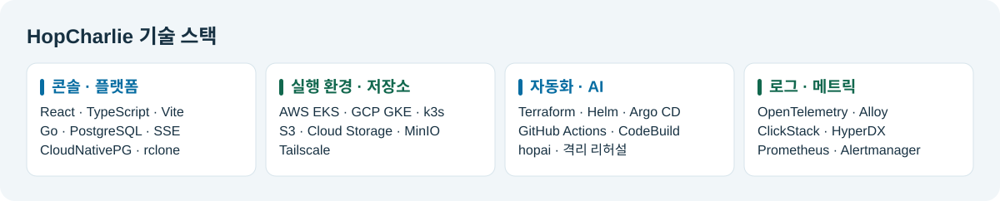
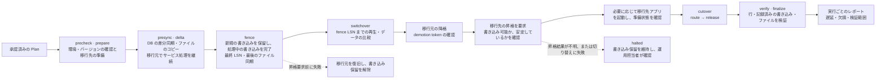
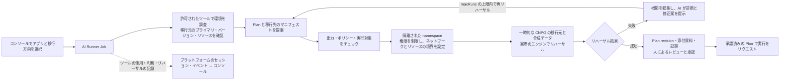

<!-- GitHub の組織プロフィールからも文書や画像を開けるように、絶対 URL を使用しています。 -->

  

<h1 align="center">HopCharlie</h1>

<strong>稼働中のアプリの移行を計画し、切り替え結果を検証します。</strong>

AWS・GCP・オンプレミス間で DB とファイルを同期し、 運用担当者が承認した計画に沿ってトラフィックを切り替える管理プラットフォームです。

  <a href="https://github.com/2026-Softbank-Hackathon-Charlie" lang="ko">한국어</a> ·
  <a href="https://github.com/2026-Softbank-Hackathon-Charlie/.github/blob/main/profile/README.en.md" lang="en">English</a> ·
  <strong>日本語</strong>

  <a href="https://github.com/2026-Softbank-Hackathon-Charlie/frontend#readme">ローカルデモ</a> ·
  <a href="https://github.com/2026-Softbank-Hackathon-Charlie/platform/blob/main/docs/e2e/2026-11-08/README.md">本選の検証記録</a> ·
  <a href="#purpose">開発の背景</a> ·
  <a href="#features">HopCharlie の提案</a> ·
  <a href="#architecture">アーキテクチャ</a> ·
  <a href="#team">チームメンバー</a>

> **SoftBank Hackathon 2026 in Korea · 本選 · Team Charlie** 
> **Beyond Lock-in** をテーマに、稼働中のアプリとデータを別の環境に移行する仕組みを実装しました。

## 開発の背景

> 「移行元がリクエストを処理している間に、データを移行できるでしょうか？」「いつトラフィックを切り替え、失敗したらどこに戻せばよいでしょうか？」

稼働中のアプリを移行するには、データのコピーとリクエストの転送先の切り替えを連携させる必要があります。HopCharlie では、運用担当者が移行計画、切り替え条件、検証結果を一つの実行記録で確認できます。

| 従来の移行で生じる課題 | HopCharlie のアプローチ |
|---|---|
| 環境が変わるたびに接続、バージョン、ポリシーの条件を確認する必要がある | 環境の事前チェックと **AI サンドボックスでのリハーサル**で計画の根拠を集める |
| 複製中にも移行元のアプリに書き込みが発生する | 移行元がリクエストを処理している間に同期し、**最後の書き込みを確認してからトラフィックを切り替える** |
| 失敗時に復旧経路やデータ欠損の有無を判断しにくい | 実行段階ごとの復旧条件と**データの照合結果・リクエストの結果**を記録する |

## サービスの機能 · HopCharlie の提案

**AI が計画を提案し、運用担当者がリハーサル結果を確認して実行を承認します。**

| 機能 | ユーザーの操作 | HopCharlie が提供する機能 |
|---|---|---|
| **移行環境の選択** | アプリ、移行元、移行先を選択 | 環境、バージョン、容量、ポリシーの事前チェック |
| **計画とリハーサル** | AI が提案した計画とその根拠を確認 | 一時的な CNPG と合成データを使った隔離環境でのリハーサル |
| **承認と同期** | 計画をレビューして承認 | PostgreSQL WAL レプリケーションと rclone によるファイルのコピー・比較 |
| **トラフィックの切り替え** | 保留、昇格、切り替えの状態を確認 | 処理中の書き込みを完了させ、移行先を検証したうえで書き込み先を一つに絞ってルーティング |
| **結果と復旧の確認** | 欠損、リクエストの結果、遅延、復旧の状態を確認 | 実行ごとのレポートを提供し、安全に復旧できる時点では移行元を復旧、それ以外は運用担当者の確認を待つ |

**基本的な操作の流れ**

1. コンソールでアプリと移行方向を選択します。
2. AI が提案した計画とリハーサルの証跡を確認します。
3. 運用担当者が計画を承認し、実行をリクエストします。
4. **同期 → 書き込み保留 → 切り替え**の進行状況を確認します。
5. 結果画面で検証範囲とリクエストの結果を確認します。

[コンソール画面を見る](https://github.com/2026-Softbank-Hackathon-Charlie/frontend/blob/main/docs/HISTORY.md) · [AI リハーサルの実装](https://github.com/2026-Softbank-Hackathon-Charlie/ai-sandbox)

## システム全体のアーキテクチャ

AWS には**管理用 EKS** と **ワークロード用 EKS** がそれぞれあります。管理用 EKS はプラットフォームとデプロイを制御し、ワークロード用 EKS は AWS にデプロイしたアプリを実行します。

| コンポーネント | 役割 |
|---|---|
| **運用コンソール · CLI** | 環境とアプリの選択、計画の承認、移行の進行状況と結果の確認 |
| **Platform API** | ポリシーと環境のチェック、計画・承認・実行の状態管理、イベントの配信 |
| **AI Runner · サンドボックス** | 環境の調査、計画の生成、隔離環境でのリハーサルと根拠の提示 |
| **Migration Engine · Gateway** | DB とファイルの同期、書き込みの保留と処理中の書き込みの完了、切り替えと復旧の判断 |
| **オブザーバビリティのパイプライン** | ClickStack でログとトレースを、Prometheus 系のツールでメトリクスとアラートを収集 |

ゲートウェイは書き込み先として一つの環境を選択します。WAL はその時点のプライマリからレプリカに流れます。切り替え後に復旧する場合は、新しいプライマリでの書き込みを反映する逆方向の移行を行います。

[Archify のインタラクティブな HTML](https://github.com/2026-Softbank-Hackathon-Charlie/.github/blob/main/profile/assets/hopcharlie-architecture.html) · [移行エンジンの設計](https://github.com/2026-Softbank-Hackathon-Charlie/migration-engine/tree/main/docs)

## インフラのアーキテクチャ

**プラットフォームと Argo CD は管理用 EKS に配置し、アプリと業務データは実行環境ごとに分離します。**

- **管理用 EKS** にプラットフォーム API、状態管理用 DB、トラフィックゲートウェイ、Argo CD を配置しました。
- **AWS ワークロード用 EKS** ではアプリを実行し、CNPG と S3 を使用しました。
- **GCP GKE** は独立した実行環境として CNPG と Cloud Storage を使い、アプリへのリクエストは Tailscale を経由しました。
- **オンプレミスの k3s** では CNPG と MinIO を使用し、Tailscale 経由のアプリへのリクエストと予約アプリの順方向の移行を確認しました。
- **デプロイ**ではビルド済みイメージのダイジェストを GitOps の宣言に記録し、Argo CD が登録済みの対象に同期します。

[インフラの README](https://github.com/2026-Softbank-Hackathon-Charlie/infra#readme) · [AWS 環境の Terraform](https://github.com/2026-Softbank-Hackathon-Charlie/infra/tree/main/terraform/environments/aws/dev) · [GKE の構築](https://github.com/2026-Softbank-Hackathon-Charlie/infra/blob/main/docs/gcp-deployment.md) · [オンプレミスでのリクエスト検証](https://github.com/2026-Softbank-Hackathon-Charlie/platform/blob/main/docs/test-records/2026-11-07-onprem-hello-world/README.md)

## 技術スタック

技術スタックをテキストで見る

| 分野 | 主な技術 |
|---|---|
| **クラウド・ランタイム** | Amazon EKS·EC2·S3, Google Kubernetes Engine (GKE)·Cloud Storage, K3s, Tailscale |
| **開発** | Go, React, TypeScript, Vite, SSE |
| **データ・移行** | PostgreSQL WAL, CloudNativePG, rclone, MinIO |
| **デプロイ・プロビジョニング** | GitHub Actions, Docker, Terraform, Helm, Argo CD, AWS CodeBuild, Amazon ECR, Artifact Registry |
| **AI・サンドボックス** | Claude, hopai, Kubernetes の隔離サンドボックス |
| **オブザーバビリティ・テスト** | OpenTelemetry, Grafana Alloy, ClickStack, HyperDX, Prometheus, Alertmanager, Langfuse, Go のテスト, Vitest |

## チームメンバー

**Team Charlie · 5名**

**RnR** は各メンバーの主な役割です。

<table>
  <thead>
    <tr>
      <th scope="col">区分</th>
      <th scope="col" align="center">조서현</th>
      <th scope="col" align="center">김동윤</th>
      <th scope="col" align="center">강종욱</th>
      <th scope="col" align="center">박준석</th>
      <th scope="col" align="center">이태훈</th>
    </tr>
  </thead>
  <tbody>
    <tr>
      <th scope="row">RnR</th>
      <td align="center">Platform · CLI Console · CI/CD Sample App</td>
      <td align="center">Infrastructure · GPU Security · CI/CD</td>
      <td align="center">CNPG · Observability</td>
      <td align="center">Migration · DB Map · AI Recommendations</td>
      <td align="center">AI Sandbox Console</td>
    </tr>
    <tr>
      <th scope="row">プロフィール</th>
      <td align="center"></td>
      <td align="center"></td>
      <td align="center"></td>
      <td align="center"></td>
      <td align="center"></td>
    </tr>
    <tr>
      <th scope="row">GitHub</th>
      <td align="center"><a href="https://github.com/csh1668">@csh1668</a></td>
      <td align="center"><a href="https://github.com/BusanGukbap">@BusanGukbap</a></td>
      <td align="center"><a href="https://github.com/timbergrizz">@timbergrizz</a></td>
      <td align="center"><a href="https://github.com/YBSeok">@YBSeok</a></td>
      <td align="center"><a href="https://github.com/totorosi">@totorosi</a></td>
    </tr>
  </tbody>
</table>

팀원별 역할 자세히 보기

| 팀원 | Main | Assist |
|---|---|---|
| 조서현 | 플랫폼 API·트래픽 게이트웨이, 앱 배포·Compose 온보딩·CLI, 운영 콘솔 실제 API 연동, 샘플 앱 개발, 플랫폼·콘솔 이미지 게시 자동화 | AI Sandbox, 이전 엔진 연동, 인프라 구성 |
| 김동윤 | GKE·온프레 인프라, GPU 추론 전환, 보안 설계·구축(접근 권한, 네트워크 격리, 취약점 점검), 보안 API·콘솔, 앱 이미지 빌드·게시와 CI 러너 운영 | AWS EKS 구성, 이주 지도·복구 화면, 이전 엔진 안전성 검증, AI Sandbox 검증 |
| 강종욱 | AWS 워크로드 DB 기반(CNPG), ClickStack·AWS/GKE 메트릭·Langfuse 관측 구축 | 이전 환경의 CNPG 호환성, Terraform 배포 자동화 |
| 박준석 | 마이그레이션 엔진·롤백·데이터 검증, 3개 환경 DB·파일 이전, 프런트엔드 이주 지도, 근거 기반 AI 이전 추천 | AI Sandbox, 온프레 배포 검증, GPU 추론 품질 검증, 관측 연동 |
| 이태훈 | AI 이전 계획·실제 엔진 샌드박스 리허설, 운영 콘솔의 이전·AI 실행 흐름 | 이전 DB 접근 권한·환경 설정, 앱 관측 API 연동 |

## ソースリポジトリ

| リポジトリ | 内容 |
|---|---|
| [platform](https://github.com/2026-Softbank-Hackathon-Charlie/platform) | プラットフォーム API、状態管理・承認・監査、デプロイの実行機能、トラフィックゲートウェイ |
| [migration-engine](https://github.com/2026-Softbank-Hackathon-Charlie/migration-engine) | CNPG・rclone アダプター、移行と復旧のステートマシン、検証 |
| [frontend](https://github.com/2026-Softbank-Hackathon-Charlie/frontend) | 運用コンソールとローカルデモ |
| [ai-sandbox](https://github.com/2026-Softbank-Hackathon-Charlie/ai-sandbox) | AI ツール、Plan のチェック、隔離環境でのリハーサルと診断 |
| [infra](https://github.com/2026-Softbank-Hackathon-Charlie/infra) | Terraform・Helm、環境ごとのインフラ、権限、オブザーバビリティ基盤 |
| [cli](https://github.com/2026-Softbank-Hackathon-Charlie/cli) | プラットフォーム API を使う運用 CLI |

デモで使用したアプリは予約サービス `moimroom-mig` です。アプリごとのデプロイ宣言は GitOps リポジトリで管理しました。

## 詳細ドキュメント

| ドキュメント | 確認できる内容 |
|---|---|
| [インフラ構成](https://github.com/2026-Softbank-Hackathon-Charlie/infra#readme) · [アプリのルーティング手順書](https://github.com/2026-Softbank-Hackathon-Charlie/infra/blob/main/docs/runbooks/app-routing.md) | 管理環境とワークロード環境、接続、デプロイ |
| [コンソール画面とローカルデモ](https://github.com/2026-Softbank-Hackathon-Charlie/frontend#readme) | コンソール画面、実際の API を使うモードとローカルシミュレーション |
| [移行エンジンの設計](https://github.com/2026-Softbank-Hackathon-Charlie/migration-engine/tree/main/docs) · [書き込み証跡の取り決め](https://github.com/2026-Softbank-Hackathon-Charlie/platform/blob/main/docs/adr/0041-committed-write-receipts.md) | 切り替えと復旧の条件、データの照合、書き込みの測定範囲 |
| [AI・サンドボックス](https://github.com/2026-Softbank-Hackathon-Charlie/ai-sandbox) · [ポリシーと同等性のチェック](https://github.com/2026-Softbank-Hackathon-Charlie/platform/tree/main/internal/preflight) | 隔離環境でのリハーサル、人による承認、ポリシーのチェック、監査モード |
| [オブザーバビリティのアーキテクチャ](https://github.com/2026-Softbank-Hackathon-Charlie/infra/blob/main/docs/clickstack-architecture.md) · [オンプレミスのオブザーバビリティ](https://github.com/2026-Softbank-Hackathon-Charlie/infra/blob/main/docs/operations/onprem-observability.md) | シグナルごとの収集経路と環境ごとの準備状況 |

稼働中の移行と復旧の流れ

AI リハーサルと人による承認の流れ

## 現在の対応範囲と今後の目標

| 区分 | 内容 |
|---|---|
| **本選でのデモと検証** | AWS↔GCP の DB リハーサル、AWS→GCP の稼働中アプリの手動切り替え、GKE→オンプレミスの順方向の移行を記録しました。 |
| **個別の検証範囲** | オンプレミスからの逆方向の復旧、すべての書き込みの証跡とセッションの整合性、環境ごとのオブザーバビリティ連携については、各実行の測定範囲に従います。 |
| **再現方法** | 本選でデモに使用した AWS・GCP 環境はイベント終了後に撤去しました。コンソールは[ローカルデモ](https://github.com/2026-Softbank-Hackathon-Charlie/frontend#readme)で開けます。 |

本選での検証結果と測定範囲

| シナリオ | 確認した結果 | 根拠 |
|---|---|---|
| **AWS EKS ↔ GCP GKE の DB リハーサル** | テストアプリに HTTP リクエストで負荷をかけながら、両方向の DB 移行が計 2 件成功しました。アプリのプロセスは EKS 上で実行しました。 | [エンジンの実行記録](https://github.com/2026-Softbank-Hackathon-Charlie/migration-engine/blob/main/docs/test-records/README.md) |
| **稼働中の予約アプリ · AWS → GCP** | 切り替え中にエンジンが停止したため、運用担当者が手動で切り替えました。確認対象の予約 1,487 件と写真 70 枚の欠損は 0 件で、書き込みリクエストは 9 件失敗しました。 | [稼働中アプリの移行記録](https://github.com/2026-Softbank-Hackathon-Charlie/migration-engine/blob/main/docs/test-records/README.md#2026-11-05-운영-moimroom-실제-이전-aws--gcp) |
| **稼働中の予約アプリ · GKE → オンプレミス** | 予約アプリの順方向の移行リハーサルは成功しました。収集したコミット済みの書き込みを基準とする欠損の有無は未測定です。 | [移行結果](https://github.com/2026-Softbank-Hackathon-Charlie/frontend/pull/118) · [測定範囲](https://github.com/2026-Softbank-Hackathon-Charlie/platform/pull/141) |
| **総合 E2E 検証** | 運用コンソールのブラウザ検証 10 件、隔離環境での CNPG の移行・復旧検証 4 件、MinIO・rclone のファイル検証 10 件に合格しました。DB とファイルは個別に検証しました。 | [総合 E2E の記録](https://github.com/2026-Softbank-Hackathon-Charlie/platform/blob/main/docs/e2e/2026-11-08/README.md) |

[総合 E2E の記録](https://github.com/2026-Softbank-Hackathon-Charlie/platform/blob/main/docs/e2e/2026-11-08/README.md) · [エンジンのテスト記録](https://github.com/2026-Softbank-Hackathon-Charlie/migration-engine/blob/main/docs/test-records/README.md) · [本選の評価基準](https://github.com/2026-Softbank-Hackathon-Charlie/.github/blob/main/agent-rules/.claude/skills/finals-constraints/SKILL.md)
