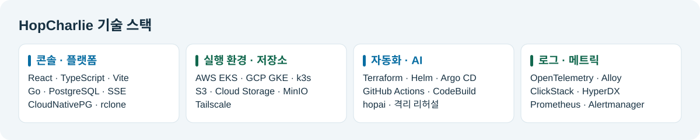
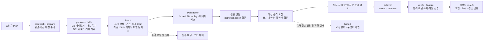
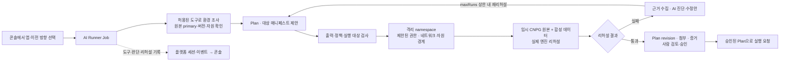

<!-- GitHub 조직 프로필에서도 문서와 이미지가 열리도록 절대 URL을 사용합니다. -->

  

<h1 align="center">HopCharlie</h1>

<strong>운영 중인 앱의 이전을 계획하고, 전환 결과를 검증합니다.</strong>

AWS·GCP·온프레미스 사이에서 DB와 파일을 동기화하고, 사람이 승인한 계획에 따라 트래픽을 전환하는 관리 플랫폼입니다.

  <strong>한국어</strong> ·
  <a href="https://github.com/2026-Softbank-Hackathon-Charlie/.github/blob/main/profile/README.en.md" lang="en">English</a> ·
  <a href="https://github.com/2026-Softbank-Hackathon-Charlie/.github/blob/main/profile/README.ja.md" lang="ja">日本語</a>

  <a href="https://github.com/2026-Softbank-Hackathon-Charlie/frontend#readme">로컬 데모</a> ·
  <a href="https://github.com/2026-Softbank-Hackathon-Charlie/platform/blob/main/docs/e2e/2026-11-08/README.md">본선 검증 기록</a> ·
  <a href="#purpose">기획 의도</a> ·
  <a href="#features">HopCharlie의 제안</a> ·
  <a href="#architecture">아키텍처</a> ·
  <a href="#team">팀 구성원</a>

> **SoftBank Hackathon 2026 in Korea · 본선 · Team Charlie** 
> **Beyond Lock-in**을 주제로 운영 중인 앱과 데이터를 다른 환경으로 옮기는 과정을 구현했습니다.

## 기획 의도

> “원본이 요청을 받는 동안 데이터를 옮길 수 있을까요?” “어느 시점에 트래픽을 바꾸고, 실패하면 어디로 돌아가야 할까요?”

운영 중인 앱을 옮기려면 데이터 복사와 요청 전환이 맞물려야 합니다. HopCharlie는 운영자가 이전 계획, 전환 조건, 검증 결과를 한 실행 기록에서 확인하도록 구성했습니다.

| 기존 이전 과정의 어려움 | HopCharlie의 접근 |
|---|---|
| 환경이 바뀔 때마다 연결·버전·정책 조건을 확인해야 함 | 환경 사전 검사와 **AI 샌드박스 리허설**로 계획의 근거를 모음 |
| 복제 중에도 원본 앱에 쓰기가 들어옴 | 원본이 요청을 처리하는 동안 동기화하고 **마지막 쓰기 확인 후 트래픽 전환** |
| 실패했을 때 복구 경로와 데이터 손실 여부를 판단하기 어려움 | 실행 단계별 복구 조건과 **데이터 비교·요청 결과**를 기록 |

## 서비스 기능 · HopCharlie의 제안

**AI가 계획을 제안하고, 운영자가 리허설 결과를 확인해 실행을 승인합니다.**

| 기능 | 사용자가 하는 일 | HopCharlie가 제공하는 것 |
|---|---|---|
| **이전 환경 선택** | 앱과 출발지·목적지 선택 | 환경, 버전, 용량, 정책 사전 검사 |
| **계획과 리허설** | AI가 제안한 계획과 근거 확인 | 임시 CNPG와 합성 데이터를 사용한 격리 리허설 |
| **승인과 동기화** | 계획 검토 및 승인 | PostgreSQL WAL 복제와 rclone 파일 복사·비교 |
| **트래픽 전환** | 보류·승격·전환 상태 확인 | 진행 중인 쓰기를 마무리하고 대상 검증 뒤 단일 쓰기 대상으로 라우팅 |
| **결과와 복구 확인** | 누락·요청 결과·지연과 복구 상태 확인 | 실행별 리포트, 안전한 시점의 원본 복구 또는 운영자 확인 대기 |

**기본 사용 흐름**

1. 콘솔에서 앱과 이전 방향을 고릅니다.
2. AI 계획과 리허설 증거를 검토합니다.
3. 운영자가 계획을 승인하고 실행을 요청합니다.
4. **동기화 → 쓰기 보류 → 전환**의 진행을 확인합니다.
5. 결과 화면에서 검사 범위와 요청 결과를 확인합니다.

[콘솔 화면 보기](https://github.com/2026-Softbank-Hackathon-Charlie/frontend/blob/main/docs/HISTORY.md) · [AI 리허설 구현](https://github.com/2026-Softbank-Hackathon-Charlie/ai-sandbox)

## 전체 시스템 아키텍처

AWS에는 **관리 EKS**와 **워크로드 EKS**가 따로 있습니다. 관리 EKS는 플랫폼과 배포를 제어하고, 워크로드 EKS는 AWS에 배포된 앱을 실행합니다.

| 구성 요소 | 책임 |
|---|---|
| **운영 콘솔 · CLI** | 환경과 앱 선택, 계획 승인, 이전 진행과 결과 확인 |
| **Platform API** | 정책·환경 검사, 계획·승인·실행 상태 관리, 이벤트 전달 |
| **AI Runner · 샌드박스** | 환경 조사, 계획 생성, 격리 리허설과 근거 제공 |
| **Migration Engine · Gateway** | DB·파일 동기화, 쓰기 보류·배수, 전환과 복구 판단 |
| **관측 파이프라인** | ClickStack으로 로그·트레이스, Prometheus 계열로 메트릭·알림 수집 |

게이트웨이는 한 환경만 쓰기 대상으로 선택합니다. WAL은 그 시점의 primary에서 replica로 흐르고, 전환 후 복구는 새 primary의 쓰기를 반영하는 역방향 이전으로 수행합니다.

[Archify 탐색용 HTML](https://github.com/2026-Softbank-Hackathon-Charlie/.github/blob/main/profile/assets/hopcharlie-architecture.html) · [이전 엔진 설계](https://github.com/2026-Softbank-Hackathon-Charlie/migration-engine/tree/main/docs)

## 인프라 아키텍처

**관리 EKS에 플랫폼과 Argo CD를 두고, 앱과 업무 데이터는 실행 환경별로 분리합니다.**

- **관리 EKS**에 플랫폼 API, 상태 DB, 트래픽 게이트웨이, Argo CD를 배치했습니다.
- **AWS 워크로드 EKS**에서 앱을 실행하며 CNPG와 S3를 사용했습니다.
- **GCP GKE**는 독립 실행 환경으로 CNPG와 Cloud Storage를 사용하고, 앱 요청은 Tailscale 경로를 사용했습니다.
- **온프레미스 k3s**는 CNPG와 MinIO를 사용했으며, Tailscale을 경유하는 앱 요청과 예약 앱 순방향 이전을 확인했습니다.
- **배포**는 빌드 이미지의 digest를 GitOps 선언에 기록하고 Argo CD가 등록된 대상에 동기화하는 흐름입니다.

[인프라 README](https://github.com/2026-Softbank-Hackathon-Charlie/infra#readme) · [AWS 환경 Terraform](https://github.com/2026-Softbank-Hackathon-Charlie/infra/tree/main/terraform/environments/aws/dev) · [GKE 구축](https://github.com/2026-Softbank-Hackathon-Charlie/infra/blob/main/docs/gcp-deployment.md) · [온프레미스 요청 검증](https://github.com/2026-Softbank-Hackathon-Charlie/platform/blob/main/docs/test-records/2026-11-07-onprem-hello-world/README.md)

## 기술 스택

기술 스택 텍스트로 보기

| 영역 | 주요 기술 |
|---|---|
| **클라우드·런타임** | Amazon EKS·EC2·S3, Google Kubernetes Engine (GKE)·Cloud Storage, K3s, Tailscale |
| **개발** | Go, React, TypeScript, Vite, SSE |
| **데이터·이전** | PostgreSQL WAL, CloudNativePG, rclone, MinIO |
| **배포·프로비저닝** | GitHub Actions, Docker, Terraform, Helm, Argo CD, AWS CodeBuild, Amazon ECR, Artifact Registry |
| **AI·샌드박스** | Claude, hopai, Kubernetes 격리 샌드박스 |
| **관측·테스트** | OpenTelemetry, Grafana Alloy, ClickStack, HyperDX, Prometheus, Alertmanager, Langfuse, Go 테스트, Vitest |

## 팀 구성원

**Team Charlie · 5명**

**Main**은 핵심 구현이나 아이디어·설계를 맡은 분야, **Assist**는 구현·연동·검증에 함께 기여한 분야입니다.

<table>
  <thead>
    <tr>
      <th scope="col">구분</th>
      <th scope="col" align="center">조서현</th>
      <th scope="col" align="center">김동윤</th>
      <th scope="col" align="center">강종욱</th>
      <th scope="col" align="center">박준석</th>
      <th scope="col" align="center">이태훈</th>
    </tr>
  </thead>
  <tbody>
    <tr>
      <th scope="row">Main</th>
      <td align="center">Backend · Frontend CLI · Sample App CI/CD</td>
      <td align="center">Infra · GPU Security · CI/CD</td>
      <td align="center">Infra Observability</td>
      <td align="center">Migration Engine Backend</td>
      <td align="center">AI Sandbox Frontend</td>
    </tr>
    <tr>
      <th scope="row">Assist</th>
      <td align="center">Infra AI Sandbox</td>
      <td align="center">Frontend · Backend AI Sandbox Migration Engine</td>
      <td align="center">Migration Engine</td>
      <td align="center">Frontend · Infra AI Sandbox</td>
      <td align="center">Migration Engine</td>
    </tr>
    <tr>
      <th scope="row">프로필</th>
      <td align="center"></td>
      <td align="center"></td>
      <td align="center"></td>
      <td align="center"></td>
      <td align="center"></td>
    </tr>
    <tr>
      <th scope="row">GitHub</th>
      <td align="center"><a href="https://github.com/csh1668">@csh1668</a></td>
      <td align="center"><a href="https://github.com/BusanGukbap">@BusanGukbap</a></td>
      <td align="center"><a href="https://github.com/timbergrizz">@timbergrizz</a></td>
      <td align="center"><a href="https://github.com/YBSeok">@YBSeok</a></td>
      <td align="center"><a href="https://github.com/totorosi">@totorosi</a></td>
    </tr>
  </tbody>
</table>

[플랫폼 기여 내역](https://github.com/2026-Softbank-Hackathon-Charlie/platform/graphs/contributors) · [인프라 기여 내역](https://github.com/2026-Softbank-Hackathon-Charlie/infra/graphs/contributors)

## 소스 저장소

| 저장소 | 포함하는 내용 |
|---|---|
| [platform](https://github.com/2026-Softbank-Hackathon-Charlie/platform) | 플랫폼 API, 상태·승인·감사, 배포 실행기와 트래픽 게이트웨이 |
| [migration-engine](https://github.com/2026-Softbank-Hackathon-Charlie/migration-engine) | CNPG·rclone 어댑터, 이전·복구 상태 머신과 검증 |
| [frontend](https://github.com/2026-Softbank-Hackathon-Charlie/frontend) | 운영 콘솔과 로컬 데모 |
| [ai-sandbox](https://github.com/2026-Softbank-Hackathon-Charlie/ai-sandbox) | AI 도구, Plan 검사, 격리 리허설과 진단 |
| [infra](https://github.com/2026-Softbank-Hackathon-Charlie/infra) | Terraform·Helm, 환경별 인프라·권한·관측 기반 |
| [cli](https://github.com/2026-Softbank-Hackathon-Charlie/cli) | 플랫폼 API를 사용하는 운영 CLI |

시연 앱은 예약 서비스 `moimroom-mig`입니다. 앱별 배포 선언은 GitOps 저장소에서 관리했습니다.

## 상세 문서

| 문서 | 확인할 내용 |
|---|---|
| [인프라 구성](https://github.com/2026-Softbank-Hackathon-Charlie/infra#readme) · [앱 라우팅 런북](https://github.com/2026-Softbank-Hackathon-Charlie/infra/blob/main/docs/runbooks/app-routing.md) | 관리·워크로드 환경, 연결과 배포 |
| [콘솔 화면과 로컬 데모](https://github.com/2026-Softbank-Hackathon-Charlie/frontend#readme) | 콘솔 화면, 실제 API 모드와 로컬 시뮬레이션 |
| [이전 엔진 설계](https://github.com/2026-Softbank-Hackathon-Charlie/migration-engine/tree/main/docs) · [쓰기 증거 계약](https://github.com/2026-Softbank-Hackathon-Charlie/platform/blob/main/docs/adr/0041-committed-write-receipts.md) | 전환·복구 조건, 데이터 대조와 쓰기 측정 범위 |
| [AI·샌드박스](https://github.com/2026-Softbank-Hackathon-Charlie/ai-sandbox) · [정책과 동등성 검사](https://github.com/2026-Softbank-Hackathon-Charlie/platform/tree/main/internal/preflight) | 격리 리허설, 사람 승인, 정책 검사와 감사 모드 |
| [관측 아키텍처](https://github.com/2026-Softbank-Hackathon-Charlie/infra/blob/main/docs/clickstack-architecture.md) · [온프레미스 관측](https://github.com/2026-Softbank-Hackathon-Charlie/infra/blob/main/docs/operations/onprem-observability.md) | 신호별 수집 경로와 환경별 준비 상태 |

가동 중 이전과 복구 흐름

AI 리허설과 사람 승인 흐름

## 현재 범위와 다음 목표

| 구분 | 내용 |
|---|---|
| **본선 시연과 검증** | AWS↔GCP DB 리허설, AWS→GCP 운영 앱 수동 전환, GKE→온프레미스 순방향 이전을 기록했습니다. |
| **별도 검증 범위** | 온프레미스 역방향 복구, 전체 쓰기 증거와 세션 정합성, 환경별 관측 연동은 각 실행의 측정 범위를 따릅니다. |
| **재현 안내** | 본선 AWS·GCP 시연 환경은 행사 후 정리했습니다. 콘솔은 [로컬 데모](https://github.com/2026-Softbank-Hackathon-Charlie/frontend#readme)에서 열 수 있습니다. |

본선 검증 결과와 측정 범위

| 시나리오 | 확인한 결과 | 근거 |
|---|---|---|
| **AWS EKS ↔ GCP GKE DB 리허설** | 테스트 앱에 HTTP 부하를 보내며 DB 이전 양방향 2건이 성공했습니다. 앱 프로세스는 EKS에서 실행했습니다. | [엔진 실행 기록](https://github.com/2026-Softbank-Hackathon-Charlie/migration-engine/blob/main/docs/test-records/README.md) |
| **운영 예약 앱 · AWS → GCP** | 엔진이 전환 중 멈춰 운영자가 수동으로 전환했습니다. 확인한 예약 1,487건과 사진 70장의 누락은 0건이었고, 쓰기 요청 9건이 실패했습니다. | [운영 이전 기록](https://github.com/2026-Softbank-Hackathon-Charlie/migration-engine/blob/main/docs/test-records/README.md#2026-11-05-운영-moimroom-실제-이전-aws--gcp) |
| **운영 예약 앱 · GKE → 온프레미스** | 예약 앱의 순방향 이전 리허설이 성공했습니다. 수집된 커밋 쓰기 기준의 누락 여부는 미측정입니다. | [이전 결과](https://github.com/2026-Softbank-Hackathon-Charlie/frontend/pull/118) · [측정 범위](https://github.com/2026-Softbank-Hackathon-Charlie/platform/pull/141) |
| **종합 E2E 검증** | 운영 콘솔 브라우저 검사 10개, 격리 CNPG 이전·복구 4개, MinIO·rclone 파일 검사 10개를 통과했습니다. DB와 파일은 각각 시험했습니다. | [종합 E2E 기록](https://github.com/2026-Softbank-Hackathon-Charlie/platform/blob/main/docs/e2e/2026-11-08/README.md) |

[종합 E2E 기록](https://github.com/2026-Softbank-Hackathon-Charlie/platform/blob/main/docs/e2e/2026-11-08/README.md) · [엔진 테스트 기록](https://github.com/2026-Softbank-Hackathon-Charlie/migration-engine/blob/main/docs/test-records/README.md) · [본선 평가 기준](https://github.com/2026-Softbank-Hackathon-Charlie/.github/blob/main/agent-rules/.claude/skills/finals-constraints/SKILL.md)
