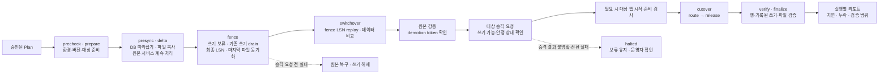
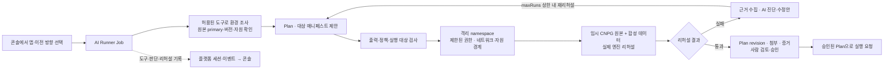

# HopCharlie

**SoftBank Hackathon 2026 in Korea · 본선 · Team Charlie**

**가동 중인 앱의 이전을 계획하고, 전환 결과를 검증합니다.**

HopCharlie는 AWS·GCP·온프레미스 사이에서 앱과 데이터를 옮기는 과정을 관리합니다. 운영자는 콘솔에서 이전 계획을 검토하고 승인한 뒤, DB·파일 동기화와 트래픽 전환의 진행 상황과 결과를 확인합니다.

[이전 흐름](#migration) · [본선 검증 결과](#evidence) · [아키텍처](#architecture) · [저장소](#repositories) · [로컬 데모 실행 안내](https://github.com/2026-Softbank-Hackathon-Charlie/frontend#readme)

## 기획 의도

가동 중인 앱을 옮기려면 원본이 요청을 처리하는 동안 DB와 파일을 동기화하고, 마지막 쓰기가 대상에 반영된 시점에 트래픽을 전환해야 합니다. HopCharlie는 본선 주제인 **Beyond Lock-in**에 맞춰 이 과정과 그 결과를 한 실행 기록으로 남깁니다.

## 이전 흐름

1. **계획** — 앱과 이전 방향을 선택합니다. 플랫폼은 환경·버전·정책을 검사하고, AI는 계획을 제안해 격리 환경에서 리허설합니다.
2. **승인** — 운영자가 리허설 결과와 계획(Plan)을 검토한 뒤 실행을 승인합니다.
3. **동기화와 전환** — 원본이 요청을 처리하는 동안 DB와 파일을 미리 동기화합니다. 마지막 반영을 확인하는 동안 새 쓰기를 보류하고, 대상 DB가 준비되면 트래픽을 전환합니다.
4. **검증과 복구** — 실행 리포트에서 검사한 데이터, 누락, 요청 실패와 지연을 확인합니다. 실패 시 전환 단계에 따라 원본으로 복구하거나 쓰기를 보류한 채 운영자 확인을 기다립니다.

## 본선 검증 결과

| 시나리오 | 확인한 결과 | 근거 |
|---|---|---|
| **AWS EKS ↔ GCP GKE DB 리허설** | 테스트 앱에 HTTP 부하를 보내며 DB 이전 양방향 2건이 성공했습니다. 앱 프로세스는 EKS에서 실행했습니다. | [엔진 실행 기록](https://github.com/2026-Softbank-Hackathon-Charlie/migration-engine/blob/main/docs/test-records/README.md) |
| **운영 예약 앱 · AWS → GCP** | 엔진이 전환 중 멈춰 운영자가 수동으로 전환했습니다. 확인한 예약 1,487건과 사진 70장의 누락은 0건이었고, 쓰기 요청 9건이 실패했습니다. | [운영 이전 기록](https://github.com/2026-Softbank-Hackathon-Charlie/migration-engine/blob/main/docs/test-records/README.md#2026-11-05-운영-moimroom-실제-이전-aws--gcp) |
| **운영 예약 앱 · GKE → 온프레미스** | 예약 앱의 순방향 이전 리허설이 성공했습니다. 수집된 커밋 쓰기 기준의 누락 여부는 미측정입니다. | [이전 결과](https://github.com/2026-Softbank-Hackathon-Charlie/frontend/pull/118) · [측정 범위](https://github.com/2026-Softbank-Hackathon-Charlie/platform/pull/141) |
| **종합 E2E 검증** | 운영 콘솔 브라우저 검사 10개, 격리 CNPG 이전·복구 4개, MinIO·rclone 파일 검사 10개를 통과했습니다. DB와 파일은 각각 시험했습니다. | [종합 E2E 기록](https://github.com/2026-Softbank-Hackathon-Charlie/platform/blob/main/docs/e2e/2026-11-08/README.md) |

본선 시연용 AWS·GCP 환경은 행사 후 정리했습니다. 콘솔은 [프런트엔드 README](https://github.com/2026-Softbank-Hackathon-Charlie/frontend#readme)의 로컬 데모 모드에서 시뮬레이션으로 살펴볼 수 있습니다.

## 전체 아키텍처

본선 시연 당시 구성입니다. 관리 EKS의 플랫폼과 AWS EKS·GCP GKE·온프레미스 k3s의 워크로드를 구분합니다.

[Archify HTML 파일](https://github.com/2026-Softbank-Hackathon-Charlie/.github/blob/main/profile/assets/hopcharlie-architecture.html)을 내려받아 브라우저에서 열면 웹 요청, 앱 배포, 이전·복구, 계획·관측 경로를 따로 볼 수 있습니다.

게이트웨이는 한 환경만 쓰기 대상으로 선택합니다. WAL은 현재 primary에서 replica로 흐르며 파일은 rclone으로 동기화합니다. 실제 이전에서 검증한 범위는 위 표에 정리했습니다.

## 가동 중 이전과 복구 경계

전환·복구 단계 보기

쓰기를 해제하기 전에 복제 위치와 DB 상태를 확인합니다. 승격 결과가 불명확하면 양쪽을 동시에 primary로 만들지 않도록 멈춥니다. cold 대상 앱이 시작하지 못한 경우에는 **트래픽 전환 전·모든 쓰기 보류 상태**라는 제한된 조건에서만 별도 복구 절차를 허용합니다. 정상 복귀는 살아 있는 새 primary의 WAL을 전달하는 역방향 이전으로 수행합니다.

비동기 복제의 환경 유실에 대한 RPO=0을 보장하지 않습니다. 누락 결과는 검사한 데이터와 수집된 쓰기 기록의 범위이며, 미측정·오류는 성공한 0건으로 바꾸지 않습니다. [엔진 계약과 검증 기록](https://github.com/2026-Softbank-Hackathon-Charlie/migration-engine/tree/main/docs)

## AI는 리허설하고, 사람은 승인한다

AI 리허설과 사람 승인 흐름 보기

실패 시 유효한 수정안이 있으면 `maxRuns` 상한 안에서 새 샌드박스로 다시 리허설합니다. 운영 이전은 사람이 승인합니다. 리허설은 실제 CNPG와 엔진을 사용해 합성 데이터로 계획을 검증합니다. [AI·샌드박스 구현](https://github.com/2026-Softbank-Hackathon-Charlie/ai-sandbox)

## 구현과 검증의 경계

| 범위 | 확인한 구현과 한계 |
| --- | --- |
| 보안·동등성 | 레지던시는 설정된 정책으로 시작을 제어합니다. 본선 시연의 동등성 검사는 감사 모드이며, 지정된 AWS·GCP 권한 요구와 지원하는 앱의 자격증명 사용을 부분 검사합니다. 미구현·설정 없음·검사 불가는 `unknown`입니다. [검사 계약](https://github.com/2026-Softbank-Hackathon-Charlie/platform/tree/main/internal/preflight) |
| 쓰기 증거 | `moimroom-mig`는 예약 INSERT와 같은 트랜잭션의 outbox를 지원합니다. 운영 수집에는 별도 설정·전용 토큰이 필요하며, 수집된 커밋 기록은 클라이언트 응답 수신이나 전체 CRUD 수집을 증명하지 않습니다. [수집 계약](https://github.com/2026-Softbank-Hackathon-Charlie/platform/blob/main/docs/adr/0041-committed-write-receipts.md) |
| 관측·최적화 | 로그·트레이스는 HyperDX/ClickStack, 메트릭·알림은 Prometheus/Alertmanager로 구분합니다. HyperDX에서 Prometheus를 조회하는 인증 경로의 검증은 후속 범위입니다. SDK·수집 설정이 있는 경로를 관측하며, 쓰기 보류 시간은 실행별 측정 결과를 따릅니다. [관측 설계](https://github.com/2026-Softbank-Hackathon-Charlie/infra/blob/main/docs/clickstack-architecture.md) |

비용 기반 자동 재배치, 세션 정합성, AI의 GPU 실사용 자동 판별은 별도 검증 범위입니다.

## 저장소와 책임

| 저장소 | 맡는 경계 |
| --- | --- |
| [platform](https://github.com/2026-Softbank-Hackathon-Charlie/platform) | API·승인·지속 상태·감사, 배포 실행기와 트래픽 게이트웨이 |
| [migration-engine](https://github.com/2026-Softbank-Hackathon-Charlie/migration-engine) | CNPG·PostgreSQL·rclone 어댑터, 이전·복구 상태 머신과 검증 |
| [frontend](https://github.com/2026-Softbank-Hackathon-Charlie/frontend) | 운영 콘솔, 실행·보안·AI 활동·검증 결과 표시 |
| [ai-sandbox](https://github.com/2026-Softbank-Hackathon-Charlie/ai-sandbox) | AI 도구·Plan 검사·격리 샌드박스·리허설·진단 |
| [infra](https://github.com/2026-Softbank-Hackathon-Charlie/infra) | Terraform·Helm, 클러스터 공통 구성·권한·관측 기반 |
| [cli](https://github.com/2026-Softbank-Hackathon-Charlie/cli) | 플랫폼 API를 사용하는 운영 CLI |

앱 배포 선언은 GitOps 저장소에서 관리했고, 실제 이전에는 예약 앱 `moimroom-mig`를 사용했습니다.

본선 평가 항목과 시연 근거

| 평가 항목 | 배점 | 설계 | 시연에서 확인할 항목 |
| --- | ---: | --- | --- |
| 완성도·데모 | 30 | DB·파일·트래픽을 묶은 이전 상태 머신, 쓰기 보류·복구 경계, 실행 리포트 | **(a)** 실제 앱에 트래픽을 보내며 이전하고 요청 지연·실패·검증 결과 확인 |
| 클라우드 활용 수준 | 30 | EKS·GKE의 공통 CNPG 계약, 저장소·게이트웨이 어댑터, 정책·환경 동등성 검사 | **(b)** 환경별 보안·거버넌스 결과와 근거를 같은 모델로 조회, 온프레미스 준비 상태 구분 |
| 팀 개발 | 20 | API·엔진·콘솔·인프라의 책임 분리, OpenAPI 계약, ADR·PR·CI | 저장소 간 계약과 설계 선택, 실제 테스트·리허설 기록 추적 |
| 재미·독창성 | 10 | 배포 이후의 **환경 이동**을 운영 대상으로 삼고, 자원 존재와 실제 사용 증거를 분리 | 같은 앱의 이전 방향·목적지를 바꾸고 `pass / fail / unknown`의 이유 확인 |
| AI 활용 | 10 | 도구를 쓰는 AI, 격리된 실제 엔진 리허설, 실패 진단·수정, 사람 승인 | **(c)** 도구 호출 → 리허설 실패·수정 → 증거 검토 → 승인 흐름 확인 |

[본선 평가 기준](https://github.com/2026-Softbank-Hackathon-Charlie/.github/blob/main/agent-rules/.claude/skills/finals-constraints/SKILL.md)

