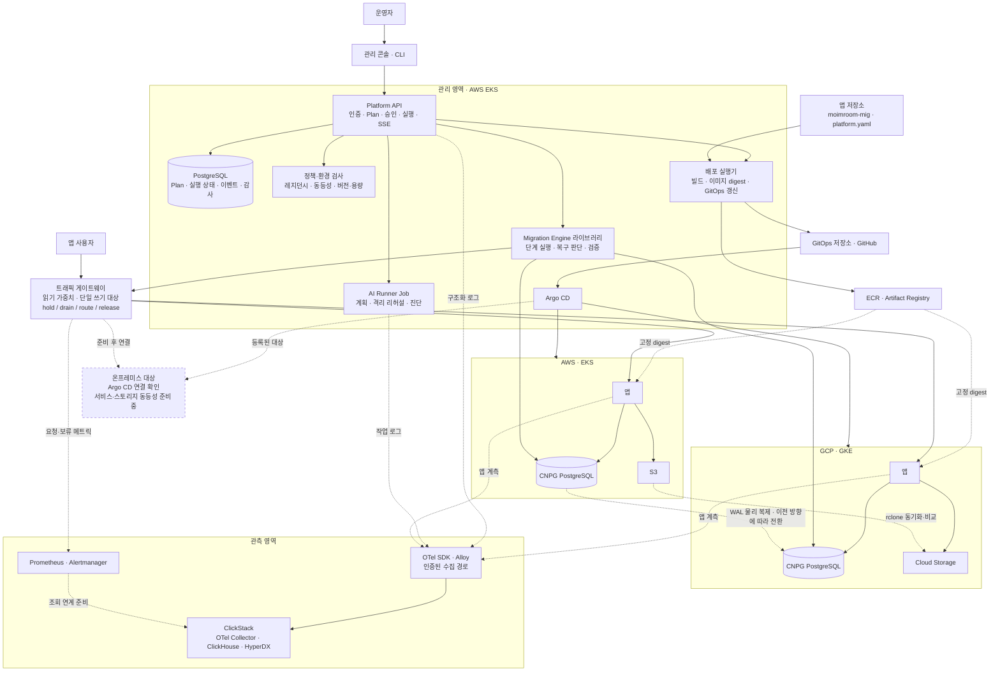
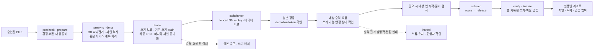
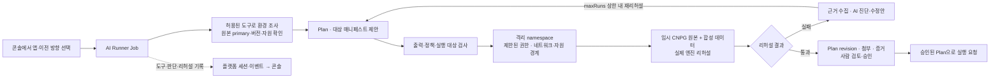

# HopCharlie

**Beyond Lock-in · 가동 중인 앱의 환경 이전을 계획하고, 검증하고, 승인한 뒤 실행하는 멀티클라우드 관리 플랫폼**

사용자는 하나의 콘솔에서 AWS·GCP·온프레미스 환경을 다룹니다. 플랫폼은 앱 배포, DB·파일 동기화, 트래픽 전환, 보안 정책과 관측을 연결하고, AI는 격리된 샌드박스에서 계획을 리허설합니다.

## 전체 아키텍처

게이트웨이는 관리 EKS에서 운영하며, 그림에서는 사용자 트래픽 경로로 분리했습니다. 한 환경만 쓰기 대상으로 선택하고, DB 복제는 현재 primary에서 replica로 흐르다가 이전 시 방향을 바꿉니다. 온프레미스의 점선은 연결된 대상과 확장 경로이며, CNPG·MinIO 등 대체 서비스의 설치·이전 완료를 뜻하지 않습니다.

## 가동 중 이전과 복구 경계

쓰기를 해제하기 전에 복제 위치와 DB 상태를 확인합니다. 승격 결과가 불명확하면 양쪽을 동시에 primary로 만들지 않도록 멈춥니다. cold 대상 앱이 시작하지 못한 경우에는 **트래픽 전환 전·모든 쓰기 보류 상태**라는 제한된 조건에서만 별도 복구 절차를 허용합니다. 정상 복귀는 살아 있는 새 primary의 WAL을 전달하는 역방향 이전으로 수행합니다.

비동기 복제의 환경 유실에 대한 RPO=0을 보장하지 않습니다. 누락 결과는 검사한 데이터와 수집된 쓰기 기록의 범위이며, 미측정·오류는 성공한 0건으로 바꾸지 않습니다. [엔진 계약과 검증 기록](https://github.com/2026-Softbank-Hackathon-Charlie/migration-engine/tree/main/docs)

## AI는 리허설하고, 사람은 승인한다

실패 시 유효한 수정안이 있으면 `maxRuns` 상한 안에서 새 샌드박스로 다시 리허설합니다. AI가 운영 이전을 스스로 승인하지 않습니다. 리허설은 실제 CNPG와 엔진을 사용하지만, 운영 앱의 전체 데이터·트래픽·세션 정합성을 그대로 재현했다는 의미는 아닙니다. [AI·샌드박스 구현](https://github.com/2026-Softbank-Hackathon-Charlie/ai-sandbox)

## 평가항목을 충족하는 구조와 시연

| 평가항목 | 배점 | 아키텍처에 넣은 솔루션 | 보여줄 근거 |
| --- | ---: | --- | --- |
| 완성도·데모 | 30 | DB·파일·트래픽을 묶은 이전 상태 머신, 쓰기 보류·복구 경계, 실행 리포트 | **(a)** 실제 앱에 트래픽을 보내며 이전하고 요청 지연·실패·검증 결과 확인 |
| 클라우드 활용 수준 | 30 | EKS·GKE의 공통 CNPG 계약, 저장소·게이트웨이 어댑터, 정책·환경 동등성 검사 | **(b)** 환경별 보안·거버넌스 결과와 근거를 같은 모델로 조회, 온프레미스 준비 상태 구분 |
| 팀 개발 | 20 | API·엔진·콘솔·인프라의 책임 분리, OpenAPI 계약, ADR·PR·CI | 저장소 간 계약과 설계 선택, 실제 테스트·리허설 기록 추적 |
| 재미·독창성 | 10 | 배포 이후의 **환경 이동**을 운영 대상으로 삼고, 자원 존재와 실제 사용 증거를 분리 | 같은 앱의 이전 방향·목적지를 바꾸고 `pass / fail / unknown`의 이유 확인 |
| AI 활용 | 10 | 도구를 쓰는 AI, 격리된 실제 엔진 리허설, 실패 진단·수정, 사람 승인 | **(c)** 도구 호출 → 리허설 실패·수정 → 증거 검토 → 승인 흐름 확인 |

## 현재 검증 범위

| 범위 | 현재 상태와 남은 경계 |
| --- | --- |
| 클라우드 이전 | EKS↔GKE 및 격리 CNPG 이전·복구 실행 기록이 있습니다. 실제 환경·데이터·부하별 결과로 판단합니다. [실행 기록](https://github.com/2026-Softbank-Hackathon-Charlie/migration-engine/tree/main/docs/test-records) |
| 온프레미스 | Argo CD 대상 연결을 확인했습니다. CNPG·S3 호환 저장소·비밀 관리·백업·관측의 동등성과 실제 이전은 추가 준비·검증 범위입니다. |
| 보안·동등성 | 레지던시는 설정된 정책으로 시작을 제어합니다. 동등성은 현재 감사 모드이며, 지정된 AWS·GCP 권한 요구와 지원하는 앱의 자격증명 사용을 부분 검사합니다. 미구현·설정 없음·검사 불가는 `unknown`입니다. [검사 계약](https://github.com/2026-Softbank-Hackathon-Charlie/platform/tree/main/internal/preflight) |
| 쓰기 증거 | `moimroom-mig`는 예약 INSERT와 같은 트랜잭션의 outbox를 지원합니다. 운영 수집에는 별도 설정·전용 토큰이 필요하며, 수집된 커밋 기록은 클라이언트 응답 수신이나 전체 CRUD 수집을 증명하지 않습니다. [수집 계약](https://github.com/2026-Softbank-Hackathon-Charlie/platform/blob/main/docs/adr/0041-committed-write-receipts.md) |
| 관측·최적화 | 로그·트레이스는 HyperDX/ClickStack, 메트릭·알림은 Prometheus/Alertmanager로 구분합니다. HyperDX에서 Prometheus를 조회하는 인증 경로의 검증은 후속 범위입니다. SDK·수집 설정이 있는 경로를 관측하며, 쓰기 보류 단축은 별도 실측·개선 중입니다. [관측 설계](https://github.com/2026-Softbank-Hackathon-Charlie/infra/blob/main/docs/clickstack-architecture.md) |

비용 기반 자동 재배치, 세션 정합성 보장, AI의 GPU 실사용 자동 판별은 현재 완료 기능으로 표시하지 않습니다.

## 저장소와 책임

| 저장소 | 맡는 경계 |
| --- | --- |
| [platform](https://github.com/2026-Softbank-Hackathon-Charlie/platform) | API·승인·지속 상태·감사, 배포 실행기와 트래픽 게이트웨이 |
| [migration-engine](https://github.com/2026-Softbank-Hackathon-Charlie/migration-engine) | CNPG·PostgreSQL·rclone 어댑터, 이전·복구 상태 머신과 검증 |
| [frontend](https://github.com/2026-Softbank-Hackathon-Charlie/frontend) | 운영 콘솔, 실행·보안·AI 활동·검증 결과 표시 |
| [ai-sandbox](https://github.com/2026-Softbank-Hackathon-Charlie/ai-sandbox) | AI 도구·Plan 검사·격리 샌드박스·리허설·진단 |
| [infra](https://github.com/2026-Softbank-Hackathon-Charlie/infra) | Terraform·Helm, 클러스터 공통 구성·권한·관측 기반 |
| [gitops](https://github.com/2026-Softbank-Hackathon-Charlie/gitops) | Argo CD가 적용하는 앱별 배포 선언 |
| [cli](https://github.com/2026-Softbank-Hackathon-Charlie/cli) | 플랫폼 API를 사용하는 운영 CLI |
| [moimroom-mig](https://github.com/2026-Softbank-Hackathon-Charlie/moimroom-mig) | 실제 이전 대상 예약 앱, DB·파일·멱등 예약·쓰기 기록 |

설계 선택과 한계는 각 저장소의 ADR·실행 기록에 남깁니다. 평가 기준의 원문은 [팀 본선 제약사항](https://github.com/2026-Softbank-Hackathon-Charlie/.github/blob/main/agent-rules/.claude/skills/finals-constraints/SKILL.md)을 따릅니다.
